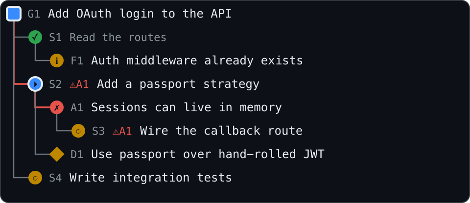
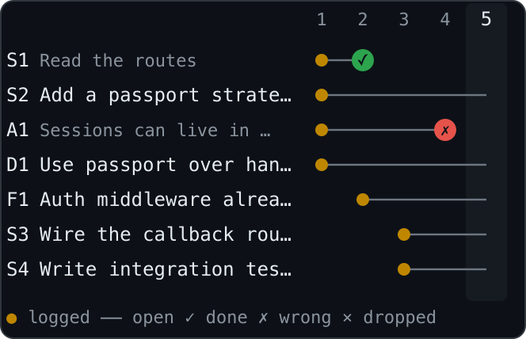
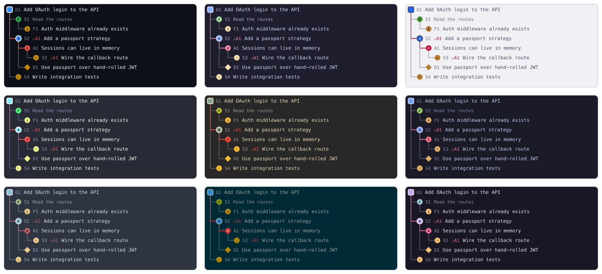

<h1 align="center">Intent Ledger</h1>

<p align="center">
  <b>A live pane that shows what your Claude Code agent is aiming for, assuming, planning and deciding,<br>so you can catch a wrong assumption before it becomes wrong code.</b>
</p>

<p align="center">
  <a href="LICENSE"></a>
  
</p>

<p align="center">
  
  
</p>
<p align="center"><sub>The Structure and History views, rendered from the mod's own SVG output. The terminal draws the same data as text.</sub></p>

## Install

```
/plugin install intent-ledger --marketplace mattbv/intent-ledger
```

Answer `y` to add the marketplace and pick a scope, then run `/ledger`. Mods are an early-access Claude Code feature; this was built and tested on Claude Code **2.1.296**, and the API can change between releases.

To update later: `claude plugin update intent-ledger@intent-ledger`, then restart Claude Code. (`/plugin install` says "Already installed" and does not update.)

To try it for one session without installing: `claude --plugin-dir ./intent-ledger`.

## Why

On a long agent session, the code is the last place a wrong assumption shows up. Intent Ledger asks the agent to state its goal, assumptions (with why and confidence), plan, decisions, questions, risks and findings as it works, and keeps them in a pane next to the transcript. You see which assumptions are still unverified, which went stale, what rests on an assumption that turned out wrong, and where the agent changed files without logging anything. You can confirm an assumption, or flag it wrong and draft the correction.

Where [Flightdeck](https://github.com/scasella/claude-flightdeck) shows what the agent *did* (cost, tools, permissions, subagents), Intent Ledger shows what it *meant*.

## What you see

The sections run attention-first. This is abridged and illustrative, not a capture of one session:

```
GOAL
Add OAuth login to the API
▸ NOW Add a passport strategy

2 open · ⚠ 1 stale · ✗ 1 · ✓ 1 · ▰▰▰▱▱▱▱▱ 2/5 · ? 1 · ! 1

ASSUMPTIONS  2 open · 1 ✓ · 1 ✗ · 1 stale
press a row to confirm or correct it
▎? A3 Sessions can live in memory for now      ▂ low · T4  ▸
 ? A1 stale Users table has an email column   ▆ high · T1  ▸
 ✗ A2 No auth middleware exists yet         T1 · by you  ▸
 ✓ A4 Express 4.x is in use                 ▄ medium · T2  ▸

OPEN QUESTIONS & RISKS
? Q1 Should refresh tokens be rotated?
! R1 The callback URL differs between staging and prod

PLAN  ▰▰▰▱▱▱▱▱ 2/5 done
▸ Add a passport strategy
· Wire the callback route
· Write integration tests

STRUCTURE
◎ G1 Add OAuth login to the API
├─ ✓ S1 Read the routes (+2)
└─ ▸ S2 ⚠A2 Add a passport strategy
   └─ ✗ A2 No auth middleware exists yet

TIMELINE
T4 you  also add logout
T4 main A2 open → invalidated — found middleware/auth.js
T5 main changed 3 files with nothing logged (routes.ts, …)

7 files touched · unlogged changes in T5
```

| Section | Shows |
| --- | --- |
| **Goal**, **NOW** and the **health strip** | the latest active goal (with "n earlier" if you have more), the step in progress, and one line of what needs attention: open and stale assumptions, invalidated and confirmed ones, a plan progress bar, open questions and risks (only the non-zero parts) |
| **Assumptions** | status (`?` open, `✓` confirmed, `✗` invalidated), confidence, the turn logged, who logged it, and a `stale` badge before the claim once it has gone unverified for N turns. Ordered open, invalidated, confirmed, dropped (newest first); the pane shows 12 |
| **Open questions & risks** | what the agent is deferring or guessing on (`?` question, `!` risk), the latest 5 |
| **Plan** | the agent's logged steps plus its todo list and task list, read automatically, and the plan you approved in plan mode (expandable). When the Structure tree is shown, the plan keeps to what is active and next |
| **Decisions**, **Findings** | choices between alternatives with the reason; facts learned that settle no assumption. The latest 4 of each |
| **Structure** | the goal, its steps and sub-steps, and the assumptions, decisions, findings, questions and risks the agent linked to them with `of` (up to 30 nodes). `⚠A1` marks every node above or below an invalidated assumption; a bold path runs to the active step; finished branches fold to `(+n)` once the tree passes 12 nodes; "n unlinked" counts entries the agent did not link. On SVG surfaces the path to an invalidated assumption is also drawn red |
| **History** | entries against turns: `○` logged, `───` still open, `✓` `✗` `×` settled. Shown once there are two turns and two entries; up to 12 turns and 14 rows |
| **Timeline** | your prompts, resolutions, warnings, and (until the tree appears) every entry logged; the latest 10. A turn that **changed files with nothing logged** raises a warning |

A thin `▎` in the left gutter marks what was added or changed since your last prompt, in every list (and a bar at the edge of the SVG tree), so you can see at a glance what the last turn did. Confidence shows as a small bar (`▂ low`, `▄ medium`, `▆ high`), and an open assumption's details turn amber as it nears going stale. The History header carries a sparkline of activity per turn.

Inline (main-screen terminal), the pane collapses to a few rows: goal, the active step, assumption counts and the latest moment. The status line reads like `ledger · 2 open assumptions · 1 stale · 1 ✗ · plan 2/5 · 1 ?`.

On the desktop app, VS Code and mobile, Structure and History are drawn as SVG cards in your chosen palette (dark by default); the terminal draws the same data as text.

Nine colour palettes are available (see [Configure](#configure)):

<p align="center"></p>

### Steering from the pane

Focus the pane (`ctrl+x tab`) and press an assumption to expand it: its reasoning, the note that resolved it, and three buttons.

- **✓ confirm** marks it confirmed by you.
- **✗ wrong (drafts a reply)** marks it invalidated and *drafts* a reply in your prompt box (`Assumption A2 ("…") is wrong: `). You finish and send it; nothing is sent for you.
- **reopen** sets it back to open.

The agent hears about each of your marks once, in its next ledger result, so it can reconcile its plan.

## How it works

The ledger is built only from what the agent produces openly:

1. **Its ledger tool** (`mcp__intent-ledger__ledger`). The mod registers it and adds a short system-prompt section asking the agent to log its goal, assumptions, steps, decisions, questions, risks and findings on multi-step tasks, and to resolve them as it learns. The tool is always loaded (not deferred). Turn the prompt off with `instructAgent: false` if you only want observed plans.
2. **Visible plans:** `TodoWrite`, `TaskCreate` / `TaskUpdate`, and the plan returned by `ExitPlanMode`.
3. **Edits** (`Edit`, `Write`, `MultiEdit`, `NotebookEdit`), for the "changed files with nothing logged" warning, which also needs `instructAgent` on.

It does not read hidden reasoning. Treat the ledger as the agent's *declared* intent; the warning shows where declared intent and actual changes diverge.

Good to know:

- Each kind has its own statuses. Goals: `active`, `done`, `dropped`. Assumptions: `open`, `confirmed`, `invalidated`, `dropped`. Steps: `open`, `active`, `done`, `dropped`. Questions: `open`, `answered`, `dropped`. Decisions, risks and findings: `open`, `dropped`. A close fit is accepted: `done` on an assumption reads as `confirmed`.
- The same text logged again while the first is unsettled, by the same writer, is one entry. A repeat of finished work is new work.
- Entries logged by a subagent carry a `sub·xxxxx` label.
- The ledger keeps up to 300 entries (settled ones are dropped first, and never the current goal), each line up to 200 characters.
- When the agent invalidates an assumption, you get a toast.

## Privacy and reach

It makes no network requests, runs no processes, reads and writes no files, and calls no model. State lives in the session and ends with it (`/clear` resets it). The things it does outside its own pane: `/ledger copy` writes the Markdown to your clipboard (or prints it), a "✗ wrong" press drafts text in your prompt box (never sent), and it shows toasts.

With `autoAllow` on, calls to its own ledger tool skip the permission prompt, including over a permission rule of yours that would ask. The tool only writes to the pane; every other tool's permissions are untouched.

## Commands

| Command | Does |
| --- | --- |
| `/ledger` or `/ledger open` | open the pane (any unrecognised argument does this too) |
| `/ledger close` | close it |
| `/ledger reset` | clear the ledger |
| `/ledger status` | print the loaded version and the settings that shape the pane (palette, `brandAccent`, `instructAgent`, ...) |
| `/ledger copy` | copy the entries and the approved plan as Markdown (printed to the transcript if there is no clipboard). It leaves out the timeline and the `of` links |

## Configure

In `/config`, or under `pluginConfigs["intent-ledger"].options` in `settings.json`:

| Option | Default | Meaning |
| --- | --- | --- |
| `instructAgent` | `true` | add the system-prompt section asking the agent to keep the ledger (also needed for the "nothing logged" warning) |
| `autoAllow` | `true` | the ledger tool skips the permission prompt |
| `observePlans` | `true` | fold todo lists, tasks and approved plans into the plan |
| `staleAfterTurns` | `3` | flag an open assumption stale after this many turns (`0` disables) |
| `openOnStart` | `true` | open the pane when a session starts (the host decides whether the pane fits) |
| `palette` | `default` | `default` follows your Claude Code theme; or `catppuccin-mocha`, `catppuccin-latte`, `dracula`, `gruvbox-dark`, `tokyo-night`, `nord`, `solarized-dark`, `rose-pine`. A named palette colours the pane text with fixed hex colours and the SVGs with the palette. Colours are adjusted where needed so text, lines and status colours stay legible on the palette's own background. The pane text is drawn on your terminal's background, so use a named palette with a matching terminal theme |
| `brandAccent` | `false` | with the `default` palette, colour the pane headers Claude orange instead of your terminal's text colour (named palettes use their own accent) |
| `statusLine` | `true` | show the summary in the status line |

## Troubleshooting

**The pane is empty.** The agent fills it by calling the ledger tool, which it does when it starts a multi-step task. Check `instructAgent` is on; todo lists show up without it if `observePlans` is on. You can also ask the agent to "log your goal and assumptions in the ledger". It is a prompt, not enforcement: whatever the agent does not log is not shown, apart from plans and the unlogged-changes warning.

**The pane does not open.** `/ledger` says why when it cannot place the pane; try a wider window and run it again.

**The pane looks like an older version, or ignores a setting.** Run `/ledger status` for the version that is loaded and `claude plugin list` for the installed one. If they say an old version, run `claude plugin update intent-ledger@intent-ledger` and restart Claude Code. On one machine the in-app update left the install record on 0.2.0 while newer versions sat in the cache; the command fixed it.

**The plugin will not load.** Check `claude --version`. Mods are early access, and this was built on 2.1.296.

**Colours look wrong in a named palette.** Named palettes use fixed hex colours drawn on your terminal's own background, so they look right with a matching terminal theme and can clash with another. How they degrade on a terminal without true colour is untested; use `default` to follow your Claude Code theme.

## Limits

- It shows declared intent, not the model's actual reasoning.
- Nothing is saved after the session ends; use `/ledger copy` to keep a Markdown copy.
- I have run it in the terminal. The desktop, VS Code and mobile layouts are covered by mock-engine tests and renders of the SVGs, not by use.

## Develop

```
claude --plugin-dir .      # edits hot-reload
claude plugin validate .
claude plugin test .
```

| File | Holds |
| --- | --- |
| `hooks/register.tsx` | the hooks: tool registration, system-prompt section, plan observation, turn bookkeeping, the pane |
| `hooks/core.ts` | pure reducers, input validation, the structure and history builders, SVG, summaries and the Markdown export |
| `hooks/palettes.ts` | the colour palettes |
| `types/index.d.ts` | the state contract |
| `tests/ledger.test.ts` | pure behaviour, plus the tool and pane exercised through the engine on terminal and desktop |

See [CONTRIBUTING.md](CONTRIBUTING.md) and the [changelog](CHANGELOG.md).

## License

[MIT](LICENSE) © Matheus Boni Vicari
